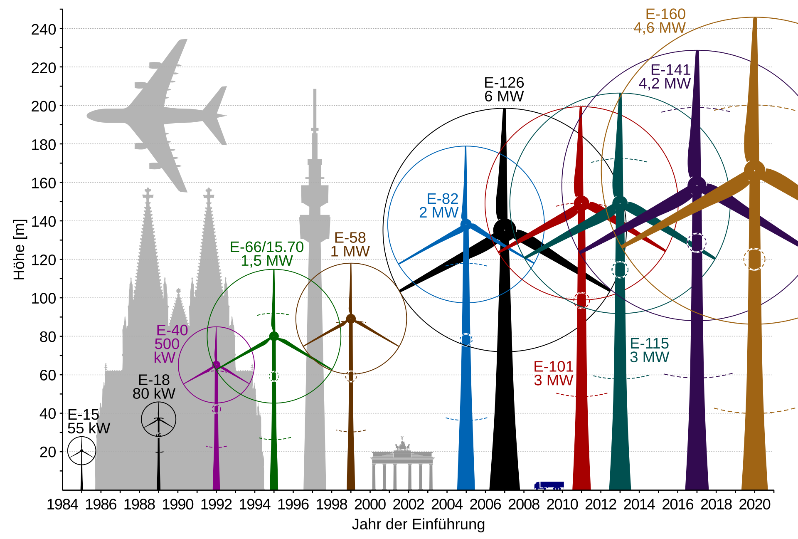

# Grid Analysis Service

Ein produktionsreifer Backend-Service in Go, der Energiedaten von SMARD mit Wetterdaten von Open-Meteo kombiniert. Er analysiert Zeiträume, in denen die Erzeugung aus erneuerbaren Energien den Verbrauch gedeckt hat.

## Features

- **Hexagonale Architektur**: Klare Trennung zwischen Domänenlogik und Infrastruktur.
- **Echtzeit-Analyse**: Abgleich von Stromverbrauch und erneuerbarer Erzeugung.
- **Resilienz**: Stabiler Betrieb durch Timeouts und Fehlerbehandlung bei externen API-Ausfällen.
- **Wetter-Kontext**: Anreicherung der Energiedaten mit Windgeschwindigkeit und Globalstrahlung.
- **Strukturierte Logs**: Slog wird für strukturierte Logs verwendet. Key Value Format erleichtert die spätere Filterung, Suche und Analyse der Logs.

## Datenquellen & Integration

### SMARD API (Bundesnetzagentur)
Wir nutzen folgende Filter für die Identifizierung erneuerbarer Energien:
- `1225`: Wind Offshore
- `4067`: Wind Onshore
- `4068`: Photovoltaik
- `4066`: Biomasse
- `1226`: Wasserkraft
- `1228`: Sonstige Erneuerbare

### Open-Meteo API
Integration von meteorologischen Daten für den Analyse-Zeitraum:
- **Wind Speed (120m)**: Für die Korrelation mit Windkraft-Erzeugung.
  - **Repräsentativer Durchschnitt**: Es trifft die Mitte zwischen dem Altbestand (80m) und den modernen Anlagen (160m+).
  - **Offshore-Kompatibilität**: Es passt sehr gut zu den gängigen Offshore-Nabenhöhen.
  - **Physikalische Korrelation**: Der Wind in 120m Höhe hat eine höhere Wahrscheinlichkeit, proportional zur tatsächlich gemessenen Einspeisung (SMARD) zu sein, als der Wind in 180m oder 10m.

> 
> Quelle: https://de.wikipedia.org/wiki/Windkraftanlage

- **Shortwave Solar Radiation (GHI)**: Für die Analyse der PV-Leistung.


## Architektur

Der Service folgt dem **Hexagonal (Ports & Adapters)** Pattern:
- `internal/core`: Domänenmodelle und Business-Logik.
- `internal/adapters`: Implementierung der API-Clients (SMARD, Open-Meteo) und des HTTP-Handlers.

## 🛠️ Setup & Start

### Voraussetzungen
- Go 1.22+

### Lokal ausführen
```bash
go run cmd/server/main.go
```

## API Dokumentation

### Analyse Endpunkt
Gibt Datenpunkte zurück, in denen die Erzeugung >= Verbrauch war.

**Anfrage:**
`GET /api/v1/analysis?start=2024-01-01T00:00:00Z&end=2024-01-02T00:00:00Z`